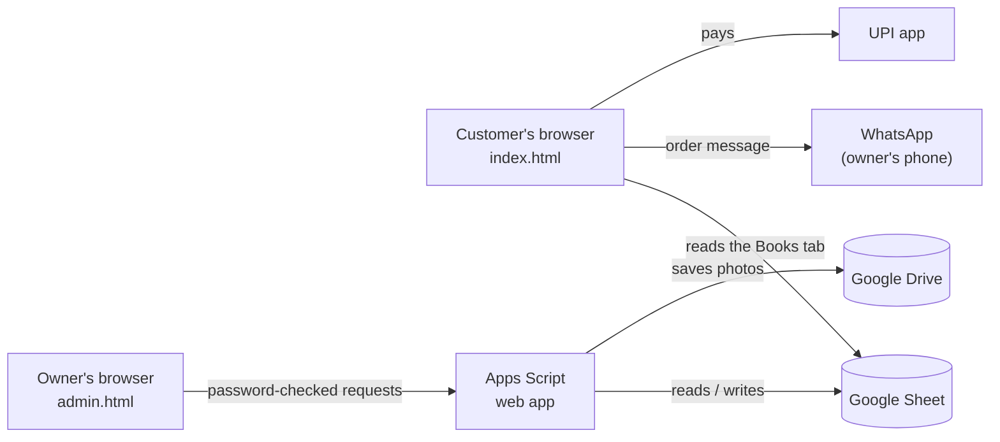

# Bigpot Publication

The website and shop dashboard for **Bigpot Publication**, an independent printing press in Kharagpur that publishes study material notes for RPF training and Railway Engineering in Hindi and English.

- **Website:** https://profoncode-debug.github.io/Bigpot-Publication/
- **Admin dashboard:** https://profoncode-debug.github.io/Bigpot-Publication/admin.html

The project has no server and no database bill. The site is plain HTML, CSS and JavaScript on free static hosting. A **Google Sheet** stores the data, a small **Google Apps Script** controls who can write to it, customers order on **WhatsApp**, and they pay by **UPI**. The running cost is ₹0 a month.

---

## How it works without a server

The usual stack for an online shop is a web server, a database, an admin panel and a payment gateway, and each of these costs money every month. This project gets the same jobs done with free services the business already uses:

| What a shop needs | Usual way | What this project uses | Cost |
|---|---|---|---|
| Hosting the website | VPS or app server | GitHub Pages (static files) | Free |
| Database | Postgres, Supabase, etc. | A Google Sheet | Free |
| Backend / admin API | Node or PHP server | Google Apps Script web app | Free |
| Login for the owner | Auth service | Password checked by the script, signed token | Free |
| Photo storage | S3 / cloud bucket | Google Drive folder | Free |
| Checkout | Cart + payment gateway | WhatsApp message + UPI QR | Free (no gateway fees) |



1. **A customer opens the website.** The page loads instantly from GitHub Pages using the built-in book list. In the background it fetches the live list from the Sheet and swaps it in, so prices, stock and new books are always current.
2. **The customer builds an order** and taps *Order on WhatsApp*. The site opens WhatsApp with a ready-written message: every book, quantity, price, total, name and address. They can pay first with the **UPI QR** on the site, or pay later.
3. **The owner gets the order on WhatsApp**, copies it into the dashboard's *Record sale* form, and the form fills itself in. Saving the sale updates stock, cost and profit in the Sheet.
4. **The owner edits books in the dashboard.** The Apps Script checks the password, writes to the Sheet, and the website shows the change.

Because the Sheet is the database, the owner can also open it directly in Google Sheets at any time to read, filter, print or download everything.

---

## Features

### Website (`index.html`)
- Animated hero with a train and a cover carousel that turns one book at a time.
- Catalogue with search, category filters and *View all*. Each book has a multi-page preview that you can swipe on a phone, and a full-screen **zoom** (pinch, scroll wheel, double-tap, drag to move) for reading the pages.
- An order list that is remembered on the device, then sent as one WhatsApp message.
- UPI payment with a QR code, a copy-UPI-ID button and a pay-in-app link on phones.
- An enquiry form for bulk orders that also sends to WhatsApp.
- Works well on phones, tablets and desktops.

### Admin dashboard (`admin.html`)
- **Overview:**
  - Sales, gross profit, expenses, net profit, payments still to collect and stock value. Choose the period: this month, last month, last 3 months, this financial year (from April), this calendar year or all time.
  - A 12-month chart of sales against net profit, which can be switched to a table.
  - Best sellers, books running low, recent orders, and warnings such as a book with no cost price.
- **Sales:**
  - Record an order with several books, quantity, price, discount, payment mode, and paid or pending status.
  - **Paste a WhatsApp order** from the website and the form fills itself in.
  - Tap an order to mark it paid; delete an order to put its copies back in stock.
- **Books:** add or edit books, upload photos (they're shrunk on the phone before uploading), reorder books, show or hide them, and set the price, cost per copy, stock and low-stock alert.
- **Stock:** copies, cost, margin and value for every book. *Add new copies* records a print run. The cost per copy becomes the average of the old and new copies, weighted by how many of each.
- **Expenses:** shipping, packaging, ads, rent and so on, with totals by category.

The **cost per copy comes from the Sheet**. Each sale saves the cost at the moment it was recorded, so changing a price later never rewrites past profit. When the last copy sells, the book shows as *out of stock* on the website by itself.

---

## The Google Sheet

| Tab | Visible to the public? | What's in it |
|---|---|---|
| **Books** | Yes — the website reads it | title, category, description, price, in stock, photos, order |
| **Inventory** | No | cost per copy, copies in stock, low-stock level |
| **Sales** | No | one row per book sold: price, discount, cost, profit, payment |
| **Expenses** | No | everything spent that isn't buying books |
| **Restocks** | No | each print run or purchase of new copies |
| **Summary** | No | all-time totals as live formulas |

The script creates any missing tab and column by itself. Templates are in [`sheet-template/`](sheet-template/): one `.xlsx` with every tab already set up, plus a CSV for each tab.

**Profit maths**
```
amount       = copies × price − discount
cost         = copies × cost per copy (taken from Inventory at the time of sale)
gross profit = amount − cost
net profit   = gross profit − expenses
```
New copies are stock, not an expense. Their cost is counted only when a copy is sold, so profit isn't counted twice.

---

## Setting it up

You need a Google account for the business and a GitHub account.

1. **Make the Sheet.** Upload `sheet-template/Bigpot-Sheet.xlsx` to Google Drive, open it, then choose **File → Save as Google Sheets**.
2. **Add the script.** In the Sheet, go to **Extensions → Apps Script**. Paste in [`apps-script/Code.gs`](apps-script/Code.gs) and save.
3. **Set a password.** Go to **Project Settings → Script properties** and add `ADMIN_PASSWORD` with a long password.
4. **Deploy.** Choose **Deploy → New deployment → Web app**, with *Execute as:* **Me** and *Who has access:* **Anyone**. Copy the URL ending in `/exec`.
5. **Configure the site.** In [`assets/js/config.js`](assets/js/config.js), set:
   - `adminApiUrl`: the `/exec` URL.
   - `sheetCsvUrl`: either `""` (the site reads books through the script), or a *Publish to web → Books tab only → CSV* link (faster, cached by Google for about 5 minutes).
   - `whatsappNumber`, `upiId`, `upiName` and `defaultPrice`.
6. **Host it.** Push to GitHub, then go to **Settings → Pages → Deploy from branch → `main` / root**. Netlify also works: [`netlify.toml`](netlify.toml) is already set up and there is no build step.

After editing `Code.gs`, choose **Deploy → Manage deployments → ✏ → New version**. The URL stays the same.

**Running it locally:** open `index.html` in a browser, or run any static server (for example `npx serve .`). There's nothing to install or build.

---

## Security

- The website itself can only **read** the Books tab. The other tabs are never sent to visitors.
- **Writes go through the Apps Script only**, and every request must carry a token.
  - The token is signed with HMAC-SHA256 using the admin password and lasts 14 days.
  - Changing the password signs every device out.
- **Wrong passwords:** 8 wrong attempts lock sign-in for 15 minutes.
- **Formula injection:** text that starts with `=`, `+`, `-` or `@` is stored as plain text, so it can't run as a Sheet formula.
- **Simultaneous edits:** a script lock stops two saves from colliding.
- **Photo uploads:** only JPG, PNG or WebP files up to 8 MB are accepted.
- **Publishing the Sheet:** if you use the CSV option, publish **only the Books tab**, never *Entire document*. Publishing the whole document would make costs, sales and customer phone numbers public.

---

## Limits to know about

- Google's free quotas are far more than a small press needs (thousands of requests a day). Each dashboard action takes about 1–3 seconds because Apps Script is not instant.
- Orders are recorded by the owner from WhatsApp; there is no automatic checkout. That is a deliberate choice: no gateway fees, and every customer gets a personal reply.
- The published CSV can be up to about 5 minutes behind the Sheet. Reading through the script is instant but a little slower to load.
- A Sheet comfortably holds tens of thousands of sales rows. Beyond that, start a new Sheet each year.

---

## Project structure

```
index.html              Website
admin.html              Owner dashboard (not linked from the site, noindex)
assets/
  css/style.css         Website styles (and shared design tokens)
  css/admin.css         Dashboard styles
  js/config.js          Settings: WhatsApp number, UPI, Sheet / script links
  js/data.js            Built-in book list, shown instantly and used as a fallback
  js/app.js             Website logic: catalogue, carousel, order list, UPI, WhatsApp
  js/admin.js           Dashboard logic: finance maths, chart, sales, stock, expenses
  img/                  Logo, icons, UPI QR
apps-script/Code.gs     The admin API that runs on Google Apps Script
sheet-template/         Ready-made Sheet (.xlsx) and one CSV per tab
RPF BOOKS/, RAILWAY ENGINEERING BOOKS/   Book page images
netlify.toml            Optional Netlify hosting config
```

Built with plain HTML, CSS and JavaScript, with no frameworks and no build tools. The only outside resource is Google Fonts.

---

## Contact

**Bigpot Publication** · Kaushallya, Kharagpur 721301, West Bengal, India
📞 +91 94758 04029 · ✉ bigpotpublication@gmail.com

Made with ❤ by [prof_on_code](https://github.com/profoncode-debug)
